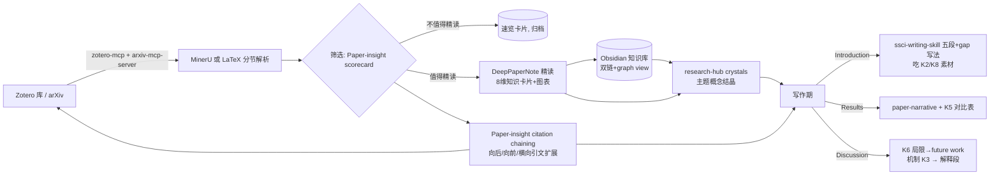

# 寻找适合 AI Agent 的科研阅读工具 —— GitHub 项目调研报告

> **主题**：将论文 PDF 转化为结构化、易读的知识卡片（而非简单摘要），并形成概念笔记与知识网络，最终服务 SCI/SSCI 论文的 Introduction / Results / Discussion 写作。
>
> **数据快照日期**：2026-09-06（Star 数、更新时间均为该日通过 GitHub API 实测）
> **调研方法**：agent-reach 全网调研（GitHub CLI 检索 30+ 组关键词、Exa 语义搜索中英文社区讨论、逐项目 README 深读）
> **调研范围**：GitHub 开源项目为主，兼看 Agent Skill / MCP / Zotero & Obsidian 插件 / 自托管 Web 应用 / 闭源 SaaS 对照

---

## 目录

1. [需求拆解：你要的到底是什么](#1-需求拆解)
2. [评估框架：六项标准 + 八维知识卡片](#2-评估框架)
3. [赛道全景图](#3-赛道全景图)
4. [核心命中：Tier A 深度阅读 → 知识卡片工具（重点评测）](#4-tier-a-核心命中)
5. [知识网络与内化层](#5-知识网络与内化层)
6. [文献接入层：MCP 与插件](#6-文献接入层)
7. [PDF 解析底座](#7-pdf-解析底座)
8. [理解增强层：带引文的问答与综合](#8-理解增强层)
9. [写作转化层：从知识卡片到 SCI/SSCI 稿件](#9-写作转化层)
10. [综合对比矩阵](#10-综合对比矩阵)
11. [推荐组合方案（三套工作流）](#11-推荐组合方案)
12. [闭源 SaaS 对照与排除理由](#12-闭源-saas-对照)
13. [明确排除项及理由](#13-明确排除项)
14. [风险与局限](#14-风险与局限)
15. [附录：检索方法与数据说明](#15-附录)

---

## 1. 需求拆解

你明确拒绝了两个"近似满足"的方向，这正是本次调研的筛选主线：

| 你不要的 | 你要的 |
|---|---|
| 单纯文献管理（Zotero 收藏、分类、标签） | 深度理解：研究背景、科学问题、理论逻辑、**Research gap**、实验设计、关键结果、机制解释、**局限性** |
| 自动综述（输入主题 → 一篇"文献综述"） | **论文 → 结构化知识卡片**（固定框架、保留证据链、可复用） |
| 复述式摘要（"这篇论文提出了 X，效果很好"） | 机制拆解 + 批判性判断（创新点是否成立、结论边界在哪） |
| 知识停留在笔记里 | **概念笔记 + 知识网络**（双链、图谱、文献关联），并回流到写作 |

因此真正的转化链路是三段式：

```
论文 PDF ──(解析+精读)──▶ 结构化知识卡片（8 维框架）
                ──(归档+关联)──▶ 概念笔记 / 知识网络（Obsidian 双链与图谱）
                      ──(调用+改写)──▶ Introduction / Results / Discussion 素材
```

**关键洞察**：目前 GitHub 上没有任何一个单一项目能完整覆盖全链路。生态已经分化为四层——**解析底座、精读卡片、知识网络、写作转化**——成熟的做法是按"乐高"方式组合，而 2026 年出现的 Agent Skill 生态（Claude Code / Codex SKILL.md 规范）恰好把"精读卡片"这一最关键的缺失层补上了。

---

## 2. 评估框架

### 2.1 八维知识卡片 schema（评估每个工具"卡片质量"的标尺）

从你的需求直接导出，每个工具按这 8 维打分（✅ 深度覆盖 / 🟡 部分 / ❌ 无）：

| # | 维度 | 对应写作环节 |
|---|---|---|
| K1 | 研究背景与科学问题 | Introduction 开篇 |
| K2 | **Research gap**（缺口如何论证、是否被论文声称 vs 实际证据区分） | Introduction 中段、审稿人最挑剔处 |
| K3 | 理论逻辑与机制解释（方法为什么 work，不只是"是什么"） | Discussion 机制讨论 |
| K4 | 实验设计（设计逻辑、控制变量、数据集/样本选择理由） | Results 设计对照、自己的 Methods 借鉴 |
| K5 | 关键结果（保留关键数字、表格化，而非定性形容） | Results 对比引用 |
| K6 | 局限性（论文自述 + 工具/模型批判性补充） | Discussion 局限、Future work |
| K7 | 概念笔记（可复用的概念单元，能脱离单篇论文存在） | 全文概念地基 |
| K8 | 知识网络（与已有笔记/文献的双链、图谱、引文链） | Introduction 文献组织、Related Work |

### 2.2 六项工程与使用标准

- **S1 Agent 友好度**：是否以 Skill / MCP / CLI / API 形态存在，能否被 AI Agent 自主调用（而非人工点按的 GUI）；
- **S2 结构化输出**：固定 schema（YAML frontmatter / JSON / Markdown 模板），可被下游工具消费；
- **S3 证据绑定**：区分"论文声称 / 实验支持 / 推断 / 猜想"，控制幻觉；
- **S4 知识库归档**：输出能否直接落入 Obsidian/双链体系（含图片、公式、表格）；
- **S5 活跃度与成熟度**：Star、创建/最近提交时间、文档质量、license；
- **S6 成本与隐私**：本地优先程度、是否强绑定特定 API。

---

## 3. 赛道全景图

```
                    ┌─────────────────────────────────────────────┐
                    │            论文阅读转化全链路                 │
                    └─────────────────────────────────────────────┘

 ① 解析底座          ② 精读卡片（核心命中）        ③ 知识网络            ④ 写作转化
 PDF→结构化MD        PDF→8维知识卡片               内化与关联             卡片→稿件
 ┌──────────┐      ┌────────────────────┐      ┌──────────────┐     ┌──────────────┐
 │ MinerU    │      │ DeepPaperNote ⭐    │      │ Obsidian     │     │ AcademicForge │
 │ 79.3k★   │      │ 1036★ skill        │      │ obsidian-    │     │ 2519★ skills │
 │ marker    │────▶ │ Paper-insight-skill│────▶ │  copilot 7.7k│───▶ │ ssci-writing- │
 │ 39.5k★   │      │ 52★ skill          │      │ citation-    │     │  skill (SSCI) │
 │ docling   │      │ paper-lens 22★     │      │  plugin 1.3k │     │ academic-     │
 │ 66.1k★   │      │ yanxi-paper-note   │      │ research-hub │     │  writing 444★ │
 └──────────┘      │ TellMeTheGap 等    │      │ 54★ MCP+CLI  │     │ PaperDebugger │
                   └────────────────────┘      │ open-notebook│     │ 1530★        │
 ⓪ 文献接入层            ▲                     │ 38.3k★       │     │ gpt_academic  │
 ┌──────────────────┐    │                     │ GraphRAG/LightRAG  │ 71.3k★       │
 │ zotero-mcp 4.9k★ │    │ (可调用解析底座)      └──────────────┘     └──────────────┘
 │ arxiv-mcp 3.1k★  │────┘
 │ papersgpt 2.6k★  │      ⑤ 理解增强层（辅助）
 │ zotero-gpt 7.4k★ │      ┌────────────────────┐
 │ ss-mcp 系列       │      │ paper-qa 9.2k★    │  ← 带引文 RAG 问答，验证卡片内容
 └──────────────────┘      │ OpenScholar 1.6k★ │
                           └────────────────────┘
```

---

## 4. Tier A 核心命中

> 这一档直接回答你的核心诉求："不是把论文读薄，而是把论文读透并变成可复用资产"。均为 2026 年新出现的 Agent Skill / 轻量工具，命中度最高，但普遍年轻、Star 尚小——**这是赛道现状而非项目缺陷**（该生态从 2026 年上半年才随 SKILL.md 规范兴起）。

### 4.1 DeepPaperNote ⭐ 首推

- **仓库**：[917Dhj/DeepPaperNote](https://github.com/917Dhj/DeepPaperNote)
- **数据**：1036 ★｜创建 2026-03-21｜最近提交 2026-09-04（活跃）｜形态：Agent Skill（Claude Code / Codex / Cursor / Copilot / Gemini CLI 通用）
- **定位**："deep paper reading skill"——README 原话："**DeepPaperNote is a paper-reading-note workflow, not a paper-summary generator.**"（是阅读笔记工作流，不是摘要生成器）——与你的需求几乎一字不差。

**工作方式**：给 Agent 一句 `Generate a deep-reading note for this paper: Attention Is All You Need`（支持 arXiv 链接 / DOI / 本地 PDF），它自动：识别论文身份 → 聚合元数据与 PDF 证据（可优先读取 Zotero 本地记录与附件，避免重复下载）→ 生成笔记。

**对你的 8 维映射**：

| 维度 | DeepPaperNote 的实现 |
|---|---|
| K1–K2 背景与 gap | 组织 method backbone、关键结果、图表上下文与局限；强调"这篇论文到底在解决什么问题" |
| K3 机制 | "Model-led understanding"：模型负责机制拆解、方法结构、关键对比，拒绝模板化摘要 |
| K5 关键结果 | 多模型/数据集/指标对比自动转为紧凑 Markdown 表格 + 数字含义解读；**保留关键数字、公式、实现逻辑与边界条件** |
| K6 局限 | "evidence first"：笔记记录完整证据链——论文证明了什么、未证明什么、哪些实验关键、负结果/限制出现在哪、结论边界 |
| K7/K8 知识网络 | 原生 Obsidian 输出：按学科路由进知识库合适位置 → 建论文文件夹（YAML properties + 固定元数据块 + `images/` 目录 + 图表嵌入）；笔记可搜索、可链接、可长期复用 |
| 图表处理 | Image-first：可用图直接以真图插入；仅在真失败（缺图/污染/截断）时留占位符 |

**优点**：8 维命中度全场最高；直接产出"值得重读"的知识资产；Zotero 协同；无 GUI 锁定，任何支持 Skill 的 Agent 可用。
**缺点/风险**：单仓库单 skill，无检索/批量能力（需与 arxiv-mcp 配合）；作者个人项目，需观察维护；笔记质量依赖所配模型能力（需强推理模型）。

### 4.2 Paper-insight-skill ⭐ 写作转化最强

- **仓库**：[Stars-Shen/Paper-insight-skill](https://github.com/Stars-Shen/Paper-insight-skill)
- **数据**：52 ★｜创建 2026-06-08｜形态：Codex + Claude 双兼容 Skill｜license MIT｜状态 MVP
- **定位**："文献结构化阅读与研究灵感工具箱"——不止把论文读薄，而是**判断创新点、连接相关工作、把局限性转化为可验证的研究方向**。

**12 项功能地图**（README 实测摘录）：

1. **Structured Reading**：结构化读取研究问题、方法、实验、结论与局限（K1/K4/K5/K6）；
2. **Innovation Judgment**：判断新意属于问题/方法/数据/评估/理论/工程哪一层——防止被作者声称的贡献带偏（K2 批判性）；
3. **Paper Scorecard**：给新颖性、证据强度、复现性、迁移价值、阅读优先级打分——决定哪篇值得精读；
4. **Citation Chaining**：backward / forward / lateral / benchmark / **negative** 五条引文链系统拓展文献；
5. **Related Work Expansion**：按 foundational / predecessor / competitor / extension 关系构建 **literature map**；
6. **Related Work Draft**：**根据文献图谱直接生成 related work 段落草稿**（写作素材！）；
7. **Future Direction Generation**：把 limitation 转成具体研究方向 + 最小验证实验 + 优先级（Discussion/Future work 素材）；
8. **Idea Incubator**：孵化低成本实验、workshop 方向、主线论文方向、高风险高收益方向；
9. **Paper-to-Project**：判断论文哪些模块可迁移到你的项目，给出最小验证计划；
10. **Reproducibility Check**：代码、license、依赖、数据、checkpoint、复现风险；
11. **Domain Checklist**：领域化检查测量、证据、数据、评价、伦理、泛化；
12. **Literature Map**：论文关系图、时间线、对比表。

**核心原则 evidence-bound**：显式区分"论文声称 / 实验直接支持 / 合理推断 / 未验证猜想"四个证据等级——这是控制 AI 幻觉污染你笔记的关键设计，目前同类工具中独一份。

**对你的价值**：**写作转化环节覆盖最广**——related work 草稿、gap→future work 转化、文献关系图直接对应 Introduction / Discussion。与 DeepPaperNote 高度互补（后者管"单篇读透+归档"，前者管"批判判断+文献网络+成段草稿"）。

### 4.3 paper-lens

- **仓库**：[nekoneko0831/paper-lens](https://github.com/nekoneko0831/paper-lens)
- **数据**：22 ★｜创建 2026-02-25｜形态：Claude Code Skill + 可选 Web UI｜依赖 PyMuPDF
- **五模式设计**（表格为 README 原文）：

| 模式 | 用途 | 耗时 | 交互 |
|---|---|---|---|
| Speed Read 速览 | 快速消化，判断是否值得深读 | ~5 min | 一次性输出信息卡+TL;DR+创新+方法+结果+**深度问答** |
| Deep Learn 学习 | 大白话深度理解，边学边存 | 20–40 min | 多轮交互（像给非本领域聪明朋友讲解） |
| Present 展示 | 准备组会/slides | 15–30 min | 逐页讨论 |
| Batch Search 批量检索 | 按主题搜论文 | 3–5 min | 表格+选择 |
| Batch Download 批量下载 | 粘贴 ID/链接批量下载 | 1–3 min | 自动去重 |

**对你的价值**："Deep Learn 多轮交互"模式是唯一把**苏格拉底式内化**（追问、检验理解）做成显式流程的工具——契合你"帮助内化"的诉求；速览→精读→汇报的三级漏斗贴合真实阅读节奏。**局限**：无知识库归档规范、无写作转化（输出靠你自己接 Obsidian）。

### 4.4 yanxi-paper-note（研析）

- **仓库**：[hk011/yanxi-paper-note](https://github.com/hk011/yanxi-paper-note)
- **数据**：25 ★｜创建 2026-05-20｜形态：**自托管 Web 应用**（React 18 + FastAPI + SQLite）+ QwenPaw Skill 双形态
- **功能**：上传英文 PDF → MinerU VLM 解析为结构化 Markdown → 流式生成中文解读笔记；**原文 PDF / 解析 Markdown / 解读笔记三栏对照**；论文问答（文本+图片、联网搜索）；小节 AI 配图与润色（Seedream 学术信息图）；笔记导出 MD/PDF；v0.0.9 起有**文献库卡片/列表视图与文件夹归类**、阅读进度。
- **笔记结构固定为**：基础信息 → 背景动机 → 核心方法 → 实验结果 → 总结展望 → 扩展阅读。
- **对你的价值**：**唯一开箱即用的 Web 形态**（不想配 Agent 时用）；三栏对照是理解机制解释（K3）的好设计；Skill 形态无需启动后端。**局限**：依赖火山方舟 + MinerU 云服务（国内可用性好、但绑定度较高）；卡片 8 维不如 DeepPaperNote 深（无"证据链/局限性批判"层）。

### 4.5 TellMeTheGap

- **仓库**：[Nullnian/TellMeTheGap](https://github.com/Nullnian/TellMeTheGap)
- **数据**：5 ★｜创建 2026-04-18｜形态：Python CLI（PyMuPDF + Pydantic schema + OpenAI 兼容/Gemini）
- **名字即卖点**："Did you read the paper? — Yes. — **Then what is the gap?**"
- skim / deep 两模式；按 title/abstract/intro/method/results/conclusion 粗切节；结构化输出（Pydantic）导出 **Markdown + JSON**；中间产物缓存。
- **对你的价值**：代码量小、schema 明确（JSON），**最适合作为你自建知识卡片管线的骨架/参考实现**二次开发——比如把 DeepPaperNote 的笔记规范嫁接到它的解析管线上。**局限**：功能单薄，gap 分析深度依赖 prompt，无归档与网络层。

### 4.6 ChatPaper2Xmind

- **仓库**：[MasterYip/ChatPaper2Xmind](https://github.com/MasterYip/ChatPaper2Xmind)
- **数据**：590 ★｜2026-09 仍在更新｜形态：Python 桌面工具
- PDF → ChatGPT 转换 → **带图片和公式的 XMind 思维导图笔记**。
- **对你的价值**：如果你偏好思维导图式内化，这是唯一成熟选项；导图结构可导入 Obsidian Canvas / XMind 复用。**局限**：导图节点深度天然不如 Markdown 卡片，难以承载 K5 关键数字与 K6 局限性的长文本；输出不进双链体系。

### 4.7 cs-fisha/paper_agent

- **仓库**：[cs-fisha/paper_agent](https://github.com/cs-fisha/paper_agent)
- **数据**：6 ★｜创建 2026-05-09｜形态：Agent（Claude Code 类）
- 卖点："**从读懂每张图开始读懂论文**"——自动搜 arXiv、提取图表、结合图表上下文解析，生成结构化阅读笔记与调研报告。
- **对你的价值**：图表驱动理解是稀缺角度（实验图往往是 Results 的核心证据），可补 K4/K5 维度；也可借它的图表提取思路增强其他工具。**局限**：极早期（6★）。

### 4.8 research-hub ⭐ 工作流集成者

- **仓库**：[WenyuChiou/research-hub](https://github.com/WenyuChiou/research-hub)
- **数据**：54 ★｜创建 2026-04-06｜最近提交 2026-09-06（**当日仍在更新，非常活跃**）｜形态：CLI + **MCP Server** + REST API + Dashboard（pip 安装）
- **定位**："Turn your research stack into an AI-operable workspace"——不替代 Zotero / Obsidian / NotebookLM，而是**把它们连接起来让 AI Agent 操作整个工作流**。真实使用信号：一位 Lehigh 大学土木环境 PhD 日常使用，跟踪 7+ 研究簇。
- **能力**（README 对比表实测）：
  - 一条命令同时搜 arXiv + Semantic Scholar；
  - 检索结果一键 ingest 进 Zotero + Obsidian + NotebookLM 三处；
  - 生成 Obsidian paper note（含 title/authors/DOI/Zotero key/tags/cluster/status/验证元数据）；
  - 自动生成 Obsidian Bases 仪表盘（`.base` 可排序元数据表）与 graph view 配色；
  - "crystals" 概念结晶笔记（`hub/<cluster>/crystals/*.md`）——**跨论文的主题级综合笔记**，低 token 可被 MCP 工具直接读——这正是你要的"概念笔记/知识网络"层的自动化实现；
  - NotebookLM 自动 bundle/upload/generate brief/download；
  - 无需 OpenAI/Anthropic API key 即可跑通基础流程；local-first，数据在你自己的 vault。
- **对你的价值**：如果你已用 Zotero + Obsidian（+NotebookLM），这是把"文献接入→卡片归档→概念结晶→仪表盘"串成 Agent 工作流的**粘合层**；MCP 形态让 Claude 等 Agent 可以直接操作。**局限**：精读深度靠上层 skill（可叠 DeepPaperNote）；单人项目。

### 4.9 本档对照小结

| 项目 | 形态 | K2 Gap | K3 机制 | K5 结果表 | K6 局限 | K7/K8 归档网络 | 写作转化 | 成熟度 |
|---|---|---|---|---|---|---|---|---|
| DeepPaperNote | Skill | 🟡 | ✅ | ✅ | ✅✅ | ✅✅ Obsidian | 🟡 | 1036★ 活跃 |
| Paper-insight-skill | Skill | ✅✅ | ✅ | 🟡 | ✅✅→方向 | ✅ literature map | ✅✅ related work 草稿 | 52★ MVP |
| paper-lens | Skill | 🟡 | ✅ 大白话 | 🟡 | 🟡 | ❌（自己接） | 🟡 slides | 22★ |
| yanxi-paper-note | Web 应用 | 🟡 | ✅ | 🟡 | 🟡 | 🟡 库内归类 | ❌ | 25★ 可用 |
| TellMeTheGap | CLI | ✅（主打） | 🟡 | 🟡 | 🟡 | JSON schema | ❌ | 5★ 参考实现 |
| ChatPaper2Xmind | 桌面 | ❌ | 🟡 | ❌ | ❌ | XMind 导图 | ❌ | 590★ 稳定 |
| paper_agent | Agent | 🟡 | ✅ 图表 | ✅ 图 | 🟡 | 🟡 | 🟡 调研报告 | 6★ 早期 |
| research-hub | CLI/MCP | 🟡 | 🟡 | 🟡 | 🟡 | ✅✅ crystals+图谱 | 🟡 brief | 54★ 活跃 |

> 经典参照：**ChatPaper**（[kaixindelele/ChatPaper](https://github.com/kaixindelele/ChatPaper)，19.8k★）是"AI 读论文"鼻祖，但其输出是标准摘要（总结+翻译+润色+审稿意见），恰好属于你不要的"简单摘要"一类——可作速筛工具，不满足知识卡片需求。**gpt_academic**（71.3k★）强在 PDF/LaTeX 翻译、润色、交互体验，属于阅读辅助与语言层，同样不产出结构化知识资产。

---

## 5. 知识网络与内化层

> 知识卡片是"点"，这一层负责把点连成网，实现你说的"概念笔记和知识网络、将阅读内容内化"。

### 5.1 Obsidian 生态（知识网络的事实标准）

| 项目 | Star | 角色 | 说明 |
|---|---|---|---|
| [logancyang/obsidian-copilot](https://github.com/logancyang/obsidian-copilot) | 7.7k★ 活跃 | 库内 AI 问答 | 对自己的知识卡片库做 RAG 问答、改写，支持本地模型（Ollama）；是"向自己的知识网络提问"的最短路径 |
| [hans/obsidian-citation-plugin](https://github.com/hans/obsidian-citation-plugin) | 1.3k★ | 文献→笔记入口 | 在 Obsidian 内检索文献库、一键创建 literature note 并引用，是经典"文献笔记"工作流的底座 |
| [aidenlx/zotero-obsidian-note](https://github.com/aidenlx/zotero-obsidian-note) | 31★ | Zotero↔Obsidian 桥 | 从 Zotero 条目直接创建/跳转 Obsidian 笔记（比经典的 Zotero Integration 插件更轻） |
| [nocona71/obsidian-literature-note](https://github.com/nocona71/obsidian-literature-note) | 120★ | 模板 | 把 Zotero PDF 批注自动转成 literature note 的 MD 模板+CSS——你批注过的重点直接进知识网络 |

**为什么是 Obsidian 而非 Notion/Logseq**：纯本地 Markdown（Agent 可直接读写，无 API 依赖）、双链+图谱原生、`[[概念]]` 链接可被所有 Tier A 工具输出，且 `.base`/graph view 提供仪表盘。**Notion/Logseq 不是不行，而是 Agent 生态（Skill/MCP 产物约定）明显偏向 MD 文件。**

### 5.2 独立知识中枢

| 项目 | Star | 说明 | 适配判断 |
|---|---|---|---|
| [lfnovo/open-notebook](https://github.com/lfnovo/open-notebook) | 38.3k★ | 开源 NotebookLM：多来源笔记本、AI 生成学习指南/播客音频、引用回链、自托管 | 适合"多篇论文主题综合"阶段；但它产出的是笔记本内素材，**不落双链网络**——建议仅作中间综合器（research-hub 正好把它编入工作流） |
| [khoj-ai/khoj](https://github.com/khoj-ai/khoj) | 37.1k★ | 自托管"AI 第二大脑"：索引你的文档/PDF，问答+自定义 Agent+自动化 | 能力全面但学术特异性弱，作为 Obsidian 替代考虑即可，与 Tier A 组合无增益 |

### 5.3 知识图谱 RAG 底座（进阶可选）

| 项目 | Star | 说明 |
|---|---|---|
| [HKUDS/LightRAG](https://github.com/HKUDS/LightRAG) | 39.4k★ | 轻量图 RAG：把文档集抽成实体-关系图再检索，跨论文概念关联的自动化路线 |
| [microsoft/graphrag](https://github.com/microsoft/graphrag) | 35.9k★ | 微软 GraphRAG：社区层级摘要+图谱问答 |

**判断**：这两者是**给开发者造工具用的底座**，不是给你直接用的阅读工具。只有当你的知识卡片积累到数百篇、Obsidian 手工双链不够用时，才值得把卡片库喂给 LightRAG 建自动概念图谱。现阶段**不建议引入**，复杂度不匹配。

---

## 6. 文献接入层

> 让 Agent 能"拿到论文"。这一层已高度成熟，选型看你的文献库形态。

| 项目 | Star | 形态 | 核心能力 | 选型建议 |
|---|---|---|---|---|
| [54yyyu/zotero-mcp](https://github.com/54yyyu/zotero-mcp) | **4.9k★** 活跃 | MCP Server | 把 Zotero 库接入 Claude 等 Agent：检索文献、读全文/笔记/批注、摘要、引文分析，支持本地 Better BibTeX 或云端 API | **Zotero 用户首选**；与 DeepPaperNote 的 Zotero 本地记录优先策略天然衔接 |
| [cookjohn/zotero-mcp](https://github.com/cookjohn/zotero-mcp) | 1.1k★ 活跃 | Zotero 插件（内嵌 MCP） | 不用装 Python 环境，Zotero 内直接起 MCP 服务：文献检索、元数据管理、全文分析、智能问答 | 想要零依赖安装时的替代 |
| [blazickjp/arxiv-mcp-server](https://github.com/blazickjp/arxiv-mcp-server) | 3.1k★ | MCP Server | arXiv 搜索/下载/按节阅读（**原始 LaTeX 分节**——公式保真度高于 PDF 解析）、元数据 BibTeX、主题订阅，论文留本地磁盘 | 非 Zotero 用户 / arXiv 重度场景首选 |
| [papersgpt/papersgpt-for-zotero](https://github.com/papersgpt/papersgpt-for-zotero) | 2.6k★ | Zotero 插件 | 库内多模型对话/摘要（GPT/Claude/DeepSeek/GLM 等） | GUI 习惯者；非 Agent 形态 |
| [MuiseDestiny/zotero-gpt](https://github.com/MuiseDestiny/zotero-gpt) | 7.4k★ | Zotero 插件 | 经典"GPT Meet Zotero"，库内唤起式问答 | 同上，偏轻量交互 |
| [akapet00/semantic-scholar-mcp](https://github.com/akapet00/semantic-scholar-mcp) | 33★ | MCP Server | Semantic Scholar 检索、**引文图谱**、作者画像、推荐 | 补足引文链追溯（配合 Paper-insight 的 citation chaining） |
| [cs-qyzhang/zotero-ai-summary](https://github.com/cs-qyzhang/zotero-ai-summary) | 40★ | Zotero 插件 | 批量 LLM 摘要 | 只做粗筛用，属"简单摘要"，注意 |

**结论**：接入层本身不产生知识，但决定 Agent 工作流的顺滑度。推荐组合：**zotero-mcp（文献库+批注）+ arxiv-mcp-server（LaTeX 分节精读）+ semantic-scholar-mcp（引文链）**。

---

## 7. PDF 解析底座

> 知识卡片质量的天花板由解析质量决定：公式、表格、图注、双栏排版的保真度。三巨头均已成熟，直接选型即可。

| 项目 | Star | 特点 | 学术文档适配 |
|---|---|---|---|
| [opendatalab/MinerU](https://github.com/opendatalab/MinerU) | **79.3k★** | PDF/Office → LLM-ready Markdown/JSON；VLM 多模态解析模式；公式/表格强；提供云 API | ⭐ 学术首选（yanxi-paper-note 即采用其 VLM 模式）；中文文档友好 |
| [datalab-to/marker](https://github.com/datalab-to/marker) | 39.5k★ | PDF → Markdown+JSON，速度快、精度高，商用需注意 license | 英文论文效果好，管线简洁 |
| [docling-project/docling](https://github.com/docling-project/docling) | 66.1k★ | IBM 出品，深度学习版式理解，表格结构化最强，生态集成丰富 | 表格密集（Results 大表）论文时优选 |

**判断**：Tier A 的 Skill 类工具多自带轻量解析（PyMuPDF）或直接吃 PDF；当遇到**公式密集/表格复杂**的论文时，先过一遍 MinerU/docling 再把结构化 MD 喂给精读 skill，卡片质量显著提升。arXiv 论文则优先用 arxiv-mcp-server 读 LaTeX 源，公式零损失。

---

## 8. 理解增强层

> 不是卡片生成器，而是"向论文提问、验证卡片内容"的引文级 RAG——与知识卡片互补：卡片管结构，问答管细节核查。

| 项目 | Star | 说明 | 在工作流中的角色 |
|---|---|---|---|
| [Future-House/paper-qa](https://github.com/Future-House/paper-qa) | 9.2k★ | 高精度科学文档 RAG，**每个答案带引文**，学术 QA 基准（LitQA2）表现强 | 读完后向整库追问细节（"他们的对照组到底怎么设的？"），答案可回填进卡片 |
| [AkariAsai/OpenScholar](https://github.com/AkariAsai/OpenScholar) | 1.6k★ | AI2 的科研文献综合系统（RAG-LM），面向"给定问题→综合多篇文献成段输出+引文" | 对比性问题（"X 现象现有解释有哪几派？"）→ 直接产 Introduction 论述素材 |
| [3Alan/DocsMind](https://github.com/3Alan/DocsMind) | 197★ | 自托管 PDF 问答 | 轻量替代 |

---

## 9. 写作转化层

> 知识卡片最终要服务 SCI/SSCI 的 Introduction / Results / Discussion。2026 年学术 Skill 生态在写作端已经相当繁荣，按"组织/语言/检查"三档排列。

### 9.1 全流程 / 结构层（重点）

| 项目 | Star | 说明 | 写作环节映射 |
|---|---|---|---|
| [HughYau/AcademicForge](https://github.com/HughYau/AcademicForge) | **2.5k★** 活跃 | "一站式学术研究 skills 平台"：按需装配的学术 Skill 集合。与阅读直接相关的如 `literature-review`（检索、核验并综合科学文献）、`paper-narrative`（审视并重塑论文图表讲述的"故事线"） | 图表故事线 ↔ Results 写作逻辑；文献综合 ↔ Introduction |
| [maydengximin-sketch/ssci-writing-skill](https://github.com/maydengximin-sketch/ssci-writing-skill) | 9★（新） | **SSCI 社科期刊写作全流程 Skill**：选题评刊→IMRaD→**Introduction 五段逻辑（背景→小领域→缺口→目的→价值）与三大 gap 写法**→文献综述（假设 H1/H0）→方法（问卷/实验、α、kappa）→**Results（results vs discussion 分界、相关/T 检验/ANOVA 的 APA 报告）**→投稿自检；附句型库与模板 | 与你的 SSCI 目标逐节对齐；其中"研究缺口三写法"可直接吃 Paper-insight 产出的 gap 素材 |
| [ahmetbersoz/chatgpt-prompts-for-academic-writing](https://github.com/ahmetbersoz/chatgpt-prompts-for-academic-writing) | 4.9k★ | 学术写作 prompt 集（选题、语言、文献综述、研究计划） | 非 Agent 形态，当 prompt 字典用 |

### 9.2 语言与检查层

| 项目 | Star | 说明 |
|---|---|---|
| [binary-husky/gpt_academic](https://github.com/binary-husky/gpt_academic) | 71.3k★ | 论文润色/翻译/语法纠错的经典交互优化壳，多模型并行，插件生态大 |
| [bahayonghang/academic-writing-skills](https://github.com/bahayonghang/academic-writing-skills) | 444★ | **写后处理工具包**（5 个 Skill）：格式校验、语法风格润色、降 AI 编辑、引用检查、审稿人视角审查；支持 LaTeX/Typst/PDF；定位是提升已有文本而非代写 |
| [PaperDebugger/paperdebugger](https://github.com/PaperDebugger/paperdebugger) | 1.5k★ | 编辑器内（LaTeX/Overleaf 等）多 Agent 写作-审阅-修改系统 |
| [devd/Academic-Writing-Check](https://github.com/devd/Academic-Writing-Check) | 603★ | 老牌检查脚本：被动语态、模糊词、重复词、Strunk & White 忌词 |
| [aipoch/medical-research-skills](https://github.com/aipoch/medical-research-skills) | 1.8k★ | 数百个医学研究 Skill（协议设计、数据分析、证据洞见、学术写作）——医学科研方向可直接套用 |

> 另：你自己环境中已装有 `academic-ai-pattern`（降 AI/去 AI 模式审查）与 `write-it-up`（Silvia《Write It Up》写作策略知识库）两个 Skill，与上表 bahayonghang 与 AcademicForge 的功能带重叠，写作端可以先盘活存量再增量安装。

---

## 10. 综合对比矩阵

### 10.1 八维知识卡片覆盖（核心工具）

| 工具 | K1 背景/问题 | K2 Gap | K3 机制 | K4 实验设计 | K5 关键结果 | K6 局限 | K7 概念笔记 | K8 知识网络 |
|---|---|---|---|---|---|---|---|---|
| **DeepPaperNote** | ✅ | 🟡 | ✅✅ | ✅ | ✅✅ 数字+表格 | ✅✅ 证据链 | ✅ Obsidian 规范 | ✅ 学科路由+嵌入 |
| **Paper-insight-skill** | ✅ | ✅✅ 批判性 | ✅ | ✅ | 🟡 | ✅✅→研究方向 | ✅ literature map | ✅✅ 五链引文 |
| paper-lens | ✅ | 🟡 | ✅✅ 大白话 | 🟡 | 🟡 | 🟡 | 🟡 | ❌ |
| yanxi-paper-note | ✅ | 🟡 | ✅ | 🟡 | 🟡 | 🟡 | ✅ 库内卡片 | 🟡 文件夹归类 |
| TellMeTheGap | 🟡 | ✅ | 🟡 | 🟡 | 🟡 | 🟡 | ❌ | ❌ |
| ChatPaper（参照） | 🟡 | ❌ | ❌ | ❌ | 🟡 | 🟡 审稿视角 | ❌ | ❌ |
| research-hub | 🟡 | 🟡 | 🟡 | 🟡 | 🟡 | 🟡 | ✅✅ crystals | ✅✅ 图谱+Bases |

### 10.2 工程指标（2026-09-06 快照）

| 工具 | Star | 创建 | 最近提交 | 形态 | Agent 友好(S1) | 结构化(S2) | 证据绑定(S3) | 本地优先(S6) |
|---|---|---|---|---|---|---|---|---|
| DeepPaperNote | 1036 | 2026-03 | 2026-09 | Skill | ✅✅ | ✅ YAML+MD | ✅ evidence-first | ✅ |
| Paper-insight-skill | 52 | 2026-06 | 2026-06 | Skill | ✅✅ | ✅ | ✅✅ 四级证据 | ✅ |
| research-hub | 54 | 2026-04 | 2026-09(当日) | CLI+MCP | ✅✅ | ✅ | 🟡 | ✅✅ |
| paper-lens | 22 | 2026-02 | 2026-05 | Skill | ✅✅ | 🟡 | 🟡 | ✅ |
| yanxi-paper-note | 25 | 2026-05 | 2026-07 | Web/Skill | 🟡/✅ | ✅ | 🟡 | 🟡 依赖云 API |
| zotero-mcp | 4914 | 2025 | 2026-09 | MCP | ✅✅ | ✅ | n/a | ✅ |
| arxiv-mcp-server | 3112 | — | 2026-09 | MCP | ✅✅ | ✅ | n/a | ✅✅ |
| MinerU | 79309 | — | 2026-09 | 库/服务 | ✅ | ✅ MD/JSON | n/a | ✅/云 |

---

## 11. 推荐组合方案

### 方案一（主推）：Agent 原生四层流水线 —— 适合你（已用 Claude Code/ZCode、Zotero、Obsidian）



**安装清单**（一次性）：

```bash
# 1. 文献接入
pip install zotero-mcp          # 或安装 cookjohn/zotero-mcp 插件版
# arxiv-mcp-server 按其 README 配置进 MCP client

# 2. 精读卡片
git clone https://github.com/917Dhj/DeepPaperNote ~/.claude/skills/DeepPaperNote
git clone https://github.com/Stars-Shen/Paper-insight-skill ~/.claude/skills/paper-insight

# 3. 知识网络
pip install research-hub-pipeline   # research-hub（可选但推荐）

# 4. 写作转化
git clone https://github.com/maydengximin-sketch/ssci-writing-skill ~/.claude/skills/ssci-writing
git clone https://github.com/HughYau/AcademicForge   # 按需挑选 skill 子目录
```

**单篇论文的标准操作**：
1. `用 paper-insight 给这篇论文打 scorecard` → 决定精读优先级；
2. `用 DeepPaperNote 为这篇论文生成深度阅读笔记：<DOI/arXiv号/本地PDF>` → 8 维卡片落入 Obsidian；
3. `用 paper-insight 对这篇论文做 citation chaining 和 literature map` → 顺着五条引文链把相关工作变成待读队列（回到 1）；
4. 每读完一个主题簇：`用 research-hub 为该 cluster 生成 crystals` → 形成跨论文概念笔记；
5. 写作期按上图的映射表调用写作层 skill。

### 方案二：零 Agent 配置 —— 适合快速起步/换机

- **yanxi-paper-note**（自托管 Web，中文笔记+三栏对照）或闭源 SciSpace（见 §12）做精读；
- 笔记导出 Markdown 手动入 Obsidian，人工双链；
- 写作期用 ChatGPT/Claude 网页版 + `chatgpt-prompts-for-academic-writing` 的 prompt 库。
- 代价：K7/K8 靠手工，规模大了会崩。

### 方案三：本地隐私优先 —— 适合未发表数据/保密课题

- 解析：docling 或 MinerU 本地模式；精读：paper-lens / DeepPaperNote + **本地模型**（Obsidian Copilot + Ollama 可全链路离线；注意小模型对 8 维卡片的机制拆解质量会明显下降，公式密集论文建议至少用开源 32B+ 级别）；
- 问答核查：paper-qa 本地库索引；
- 写作：academic-writing-skills（本地跑）。

### 知识卡片模板（可直接作为你的 Obsidian 模板，与 DeepPaperNote 输出对齐）

```markdown
---
title: "Attention Is All You Need"
doi: 10.48550/arXiv.1706.03762
zotero: "{{zotero-key}}"
tags: [paper, transformer, seq2seq]
cluster: "序列建模"
status: deep-read        # skim | deep-read | re-read
scorecard: {novelty: 9, evidence: 8, repro: 7, transfer: 8}
---

## 1. 研究背景与科学问题 (K1)
<!-- 领域痛点 → 该文切入的具体科学问题，1 段 -->

## 2. Research Gap (K2)
- 论文声称的 gap：
- 实际证据支持的 gap：   ← evidence-bound：与上条分开写
- gap 成立与否的判断：

## 3. 理论逻辑与机制 (K3)
<!-- 方法为什么 work：核心假设、机制链条、与既有理论的关系 -->

## 4. 实验设计 (K4)
| 对比对象 | 数据/样本 | 控制变量 | 设计意图 |

## 5. 关键结果 (K5)
| 方法 | 数据集 | 指标 | 数值 | Δ vs baseline |
<!-- 保留真实数字，禁止"显著优于"式定性替代 -->

## 6. 局限与边界 (K6)
- 作者自述：
- 我的批判：            ← 供 Discussion/审稿反用
- 可转化的 future work： ← Paper-insight 产出

## 7. 概念锚点 (K7)
- [[自注意力]] · [[位置编码]] · [[机器翻译]]   ← 概念独立成笔记

## 8. 网络与延伸 (K8)
- 前驱：[[相关论文笔记]] · 后继： · 竞品：
- 引文链：backward {{n}} / forward {{n}} / lateral {{n}}
```

---

## 12. 闭源 SaaS 对照

> 调研中发现的最贴切的第三方评测（scientistinprogress.com, 2026-02）结论如下，供对照与兜底：

| 工具 | 最适场景 | 关键短板（对照你的需求） |
|---|---|---|
| **Elicit** | 200M+ 论文库检索、摘要级综合、选题筛读 | 只搜摘要/元数据不进全文；综述易失真；不接 Zotero/Mendeley |
| **SciSpace**（原 Typeset） | 单篇/多篇 PDF 深读、全文问答、引用回链（$15–30/月） | 需手动上传；输出是问答不是固定 schema 的知识卡片；不落双链 |
| **NotebookLM** | 10–50 篇已收集论文的主题综合、学习指南、音频概览（免费 50 源 / $20 Pro） | 无文献库入口；音频综述偶有幻觉；导出弱、不进知识网络 |
| **Consensus** | 明确主张的"证据是否一致"问题（PubMed/bioRxiv） | 只适合共识型问题，不适合探索性阅读 |

**判断**：SaaS 的产品形态停留在"问答/综合"层，**没有任何一家做到"固定 schema 知识卡片 + 归档进你自己的双链知识库"**——这正说明你的需求目前只能靠开源组合满足。NotebookLM 可在方案一里由 research-hub 编排为"簇级综合器"，其余不作主力。

---

## 13. 明确排除项

| 项目 | Star | 排除理由 |
|---|---|---|
| [stanford-oval/storm](https://github.com/stanford-oval/storm) | 31.2k★ | 主题→全文报告的**自动综述**系统，正是你不要的方向；但其"多视角提问"的 prompt 工程可借鉴 |
| [assafelovic/gpt-researcher](https://github.com/assafelovic/gpt-researcher) | 29.3k★ | 同上，自主深度研究 Agent，产出报告而非知识卡片 |
| [SakanaAI/AI-Scientist](https://github.com/SakanaAI/AI-Scientist) | 14.5k★ | 端到端自动科研（写论文），阅读只是其内部环节，且定位是替代而非增强研究者 |
| Zotero 本体 / Papers / EndNote | — | 纯文献管理，无理解与转化层（但其 MCP/插件生态被本方案用足） |
| [hk011/…] 类"AI 论文速读"公众号流水线 | — | 产出面向传播的解读文章，非科研级证据绑定 |

---

## 14. 风险与局限

1. **幻觉污染知识库（最高风险）**：AI 拆解的"机制解释"和"gap 判断"可能似是而非。缓解：坚持 evidence-bound 类工具（Paper-insight 四级证据、DeepPaperNote 证据链）；**卡片中的关键数字与公式必须回对原文**；可用 paper-qa 的引文级问答做抽查核查。
2. **生态早期性**：Tier A 项目多为 2026 年上半年创建的个人项目（52★/25★/22★ 级别），存在断维护风险。缓解：其产出物是普通 Markdown，可随时迁移；DeepPaperNote 已达千星且持续活跃，是其中最稳的。
3. **模型依赖**：8 维卡片的机制拆解质量强依赖所用模型（建议 Claude Opus/GPT-5 级或开源 32B+；弱模型会把"精读 skill"退化成"摘要器"）。
4. **解析瓶颈**：扫描版/公式密集 PDF 的解析质量决定卡片上限——公式密集优先 arXiv LaTeX 源，其次 MinerU VLM 模式。
5. **隐私与版权**：论文 PDF 上传第三方 API 需注意版权协议；未发表数据走方案三。
6. **过度自动化的反噬**：知识内化发生在你自己建立连接的时候。工具能接管机械劳动（元数据、图表、归档），**gap 判断与概念连接建议保持"AI 起草 + 人工裁决"**，否则知识网络只是幻觉的放大器。

---

## 15. 附录

### 15.1 检索方法（可复现）

- GitHub 检索（`gh search repos`，2026-09-06）：`paper knowledge card` / `paper reading assistant` / `paper summarizer` / `literature review AI agent` / `scientific paper agent` / `zotero mcp` / `arxiv mcp server` / `academic writing` / `literature notes` / `obsidian copilot` / `zotero gpt` / `semantic scholar mcp` / `graphrag` / `open notebook notebooklm` 等 20+ 组关键词，人工去重后对 40+ 候选逐一核验 README；
- Exa 语义搜索（中英双语）：论文转知识卡片、Obsidian/Zotero 知识网络工作流、SSCI 写作 skill、Elicit/SciSpace/NotebookLM 对比评测等 5 组查询；
- 社区讨论源：scientistinprogress.com（学术 AI 工具评测博客）等；Twitter/Reddit/小红书因无登录态未纳入（不影响结论：GitHub 与博客已覆盖主要信号）。

### 15.2 全部候选仓库速览

**Tier A（精读卡片）**：917Dhj/DeepPaperNote · Stars-Shen/Paper-insight-skill · nekoneko0831/paper-lens · hk011/yanxi-paper-note · Nullnian/TellMeTheGap · MasterYip/ChatPaper2Xmind · cs-fisha/paper_agent · WenyuChiou/research-hub
**知识网络**：logancyang/obsidian-copilot · hans/obsidian-citation-plugin · aidenlx/zotero-obsidian-note · nocona71/obsidian-literature-note · lfnovo/open-notebook · khoj-ai/khoj · HKUDS/LightRAG · microsoft/graphrag
**文献接入**：54yyyu/zotero-mcp · cookjohn/zotero-mcp · kujenga/zotero-mcp · blazickjp/arxiv-mcp-server · akapet00/semantic-scholar-mcp · papersgpt/papersgpt-for-zotero · MuiseDestiny/zotero-gpt · cs-qyzhang/zotero-ai-summary
**解析底座**：opendatalab/MinerU · datalab-to/marker · docling-project/docling
**理解增强**：Future-House/paper-qa · AkariAsai/OpenScholar · 3Alan/DocsMind
**写作转化**：HughYau/AcademicForge · maydengximin-sketch/ssci-writing-skill · bahayonghang/academic-writing-skills · PaperDebugger/paperdebugger · ahmetbersoz/chatgpt-prompts-for-academic-writing · binary-husky/gpt_academic · devd/Academic-Writing-Check · aipoch/medical-research-skills
**排除对照**：stanford-oval/storm · assafelovic/gpt-researcher · SakanaAI/AI-Scientist · kaixindelele/ChatPaper

### 15.3 一句话结论

> 你的需求 = **DeepPaperNote（单篇读透→8 维卡片→Obsidian）+ Paper-insight-skill（gap 批判→引文网络→related work/future work 素材）+ zotero-mcp / arxiv-mcp（Agent 取文）+ research-hub（簇级概念结晶与仪表盘）+ ssci-writing-skill / AcademicForge（卡片→Introduction/Results/Discussion）**；解析遇阻时加 MinerU/docling，细节存疑时用 paper-qa 引文核查。当前没有任何单项目能独扛全链路，但这条开源组合链每一环都有可用实现，且总成本仅为模型 API 费用。
